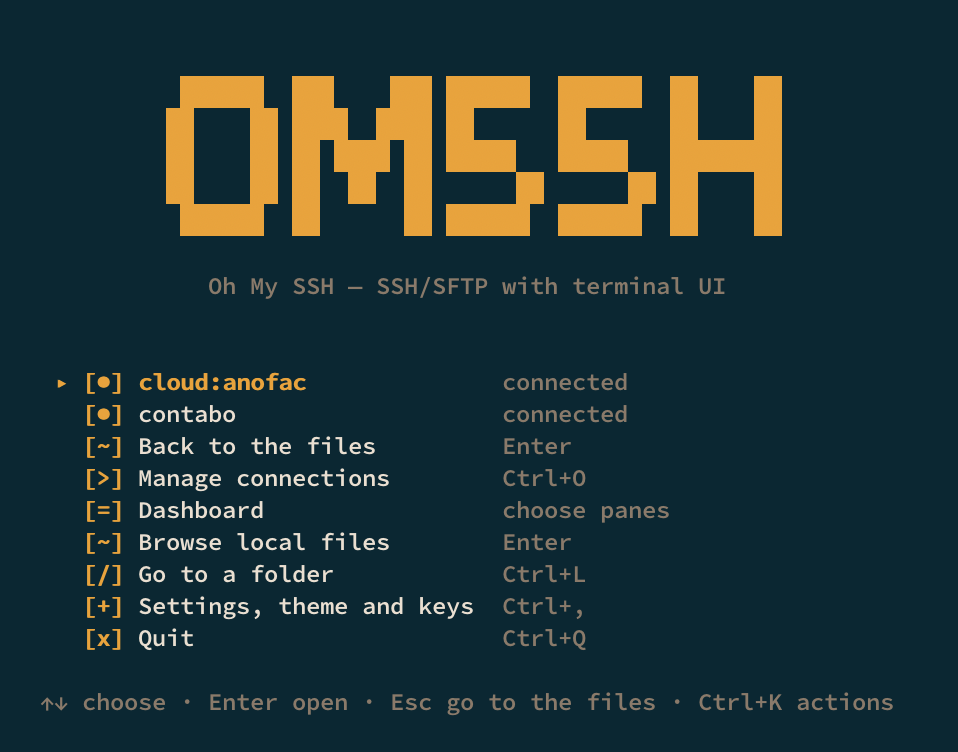

# omssh

**Oh My SSH** — a modern SSH and SFTP client for the terminal.

Many machines, one window.

<p align="center">
  
</p>

It starts on a launcher, not a blank prompt: **Manage connections** (hosts from
`~/.ssh/config` and buckets, one screen per kind), **Dashboard** (which places to
show), your local files, a path to jump to, and the settings behind one key.
Connections you already have are listed here too, so coming back is the same
gesture as going in.

<p align="center">
  
</p>

The dashboard puts up to four places on screen as a 2×2 grid — local plus three
hosts, four hosts, or a bucket in the mix — each pane with its own path, selection
and history. Which four is a choice, asked before the dashboard opens. Files move
between any two of them, and the card in the middle is where a copy becomes an
unpacked tree or a single archive instead of a pile of files.

## What it does

- **Four panes, one screen — or one.** Each keeps its own path and history.
  `w` moves between them; `V` chooses which places are on screen, and the local
  folder is optional, so four servers is a legitimate dashboard.
- **Copying that respects you.** Mark files once, paste into any pane — as files,
  as an unpacked tree, or as an archive, with the conflict rule chosen in one
  card instead of a soup of flags.
- **Archive handling on both sides.** Extract a tarball that lives on the server
  into a local folder; pack a local selection straight onto the server. No
  `tar`/`unzip` on either end.
- **Buckets as places.** S3, Cloudflare R2, Backblaze B2, Alibaba OSS, GCS,
  Azure Blob and WebDAV open in a pane like a host: copy between a bucket and a
  server, extract an archive from a bucket, deploy into one. Credentials come
  from the form (stored in the OS keyring) or the provider's own chain — never
  from the config file. Azure takes an account key, a SAS token or Entra ID; GCS
  takes HMAC keys, ADC, a service-account JSON or impersonation.
- **Recorded sessions.** `U` opens an embedded terminal; with
  `sessions.record: true` it writes an asciinema `.cast`, and `Alt+R` replays it
  with play, seek, speed and search. `T` still hands the terminal to `ssh`.
- **Deploy profiles.** A local tree to a remote root, with excludes, a reviewed
  diff, and a sync mode that mirrors. A second run with nothing changed does
  nothing.
- **A real terminal.** `t` hands the terminal to `ssh` for that host — vim, top,
  tmux and colours work because nothing stands in their way.
- **Dotfiles visible by default.** Hidden files are shown until you press `.`,
  because hiding a file by default makes you wonder where it went.
- **One manager for every place.** `Ctrl+O` has a screen per kind — Overview, SSH,
  S3 — with `a` adding whichever the screen is about, and `Tab` moving between
  them.
- **Honest about state.** Live transfers, marked files, pinned hosts and recent
  connections are visible in the sidebar; every destructive action asks first.
- **Keyboard-first, mouse-friendly.** Plain letters are commands, digits switch
  sessions, `Ctrl+K` finds any action, and `Esc` always goes back — it never
  quits.

## Install

```sh
brew tap fakihariefnoto/tap && brew install fakihariefnoto/tap/omssh
```

or

```sh
go install github.com/fakihariefnoto/omssh/cmd/omssh@latest
```

Prebuilt archives for macOS and Linux (amd64 and arm64) are on the
[releases page](https://github.com/fakihariefnoto/omssh/releases).

From source: Go 1.26 or newer.

```sh
git clone https://github.com/fakihariefnoto/omssh
cd omssh
make run
```

## First five minutes

```sh
omssh              # the launcher
omssh prod         # the interface, already connected to prod
```

1. `Ctrl+O` opens **Manage connections** — hosts and buckets, one screen per kind.
   `Enter` browses one, `t` opens a terminal on it, `a` adds one (the form asks
   whether you mean a host or a bucket). `Esc` returns to the launcher.
2. **Dashboard** on the launcher asks which places it should show — local is
   optional, and buckets need no session. Up to four panes, 2×2. `w` moves the
   focus, `Tab` cycles sessions.
3. Mark a file with `y`, move to another pane, press `p`. `A` opens the paste
   options if you want it unpacked or packed instead.
4. `Ctrl+E` extracts an archive into either side, `Ctrl+G` compresses the
   selection, `Alt+D` deploys a profile from your config.
5. `Ctrl+K` finds every action; `?` shows the keymap; `Ctrl+Q` quits.

The full guide — every key, every screen, configuration — is in
**[DOCUMENTATION.md](DOCUMENTATION.md)**. What is still missing, and in what
order: **[ROADMAP.md](ROADMAP.md)**.

## Configuration

Configuration lives in `~/.config/omssh/config.yaml` (`$XDG_CONFIG_HOME/omssh`
when set — the same path on macOS and Linux, so one config works on both). Start
from the commented example:

```sh
omssh config init     # write it
omssh config check    # validate it, with line numbers
omssh config path     # print the exact path
```

Connections are not duplicated here: `omssh` reads and writes your
`~/.ssh/config` in place, leaving comments and directives it does not manage
untouched. The config file holds preferences — theme, keymap overrides, transfer
behaviour, deploy profiles, pinned and hidden hosts, and cloud *profiles* (bucket,
region, endpoint — no secrets).

Bucket credentials entered in the form are kept in the **OS keyring**. Leave them
blank and the standard AWS chain is used instead.

## Command line

```sh
omssh                            # the interface
omssh <host>                     # the interface, connected on startup
omssh exec <host> -- <command>   # one command, its exit status
omssh cloud list                 # object-storage profiles
omssh cloud check <profile>      # list a bucket root, and say what a 403 means
omssh cloud ls <profile> [path]
omssh cloud forget <profile>     # drop the stored access key
omssh keys                       # the effective keymap
omssh config path|init|check
omssh version
```

`exec` allocates no terminal unless you ask with `--tty`, and answers what a
connection asks: it prints an unknown host key's fingerprint before trusting it,
and reads passwords without echoing.

## Development

```sh
make run              # build and launch
make build            # -> ./omssh
make check            # gofmt, vet, golangci-lint, tests with -race
make snapshot         # release archives, locally
make help             # every target
```

Ships for macOS and Linux. Windows is not claimed: the terminal and credential
paths have not been exercised there.

## Licence

MIT — see [LICENSE](LICENSE).
