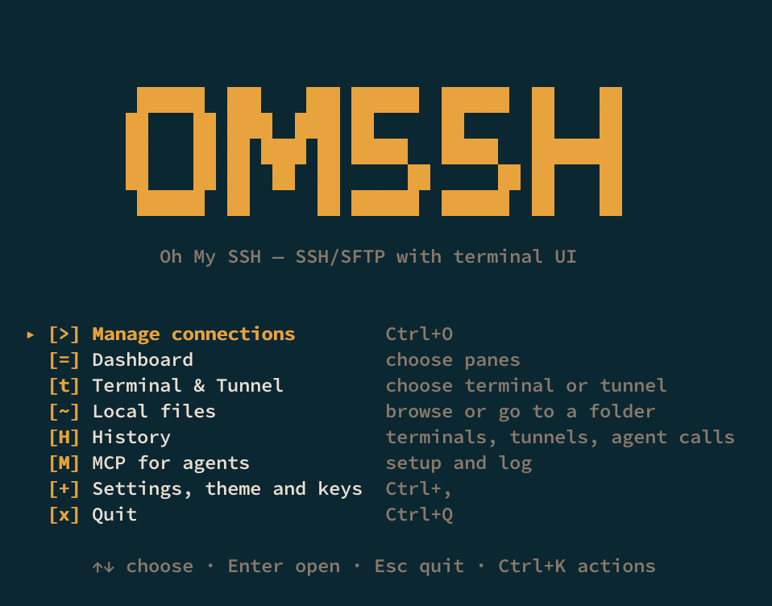
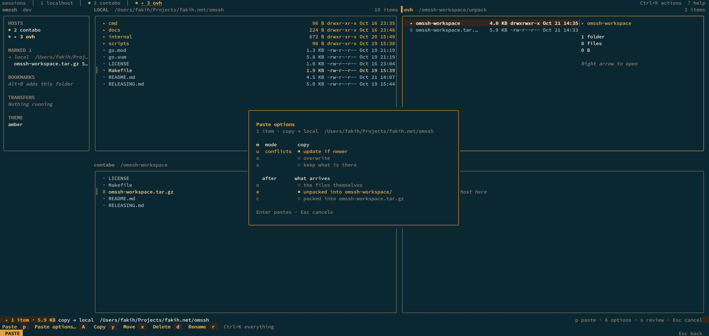
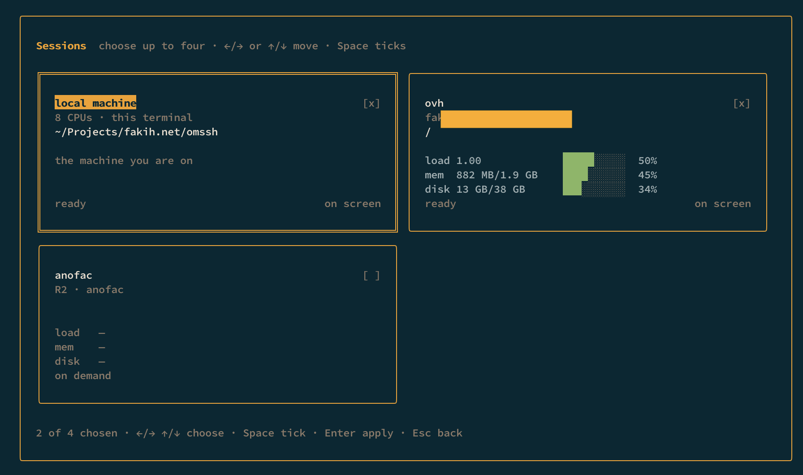
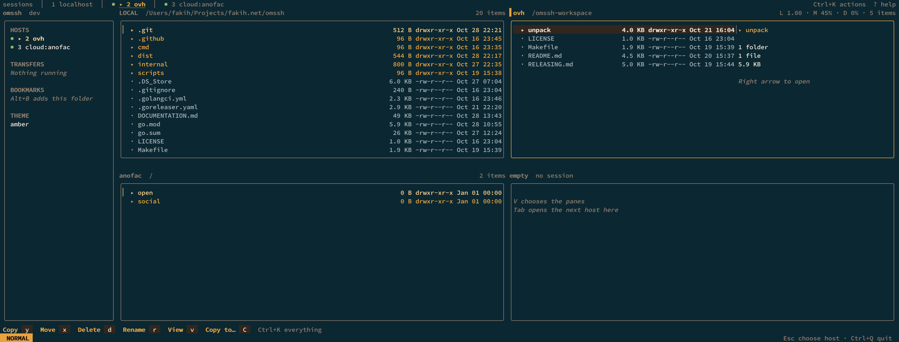
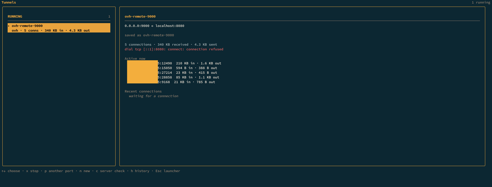
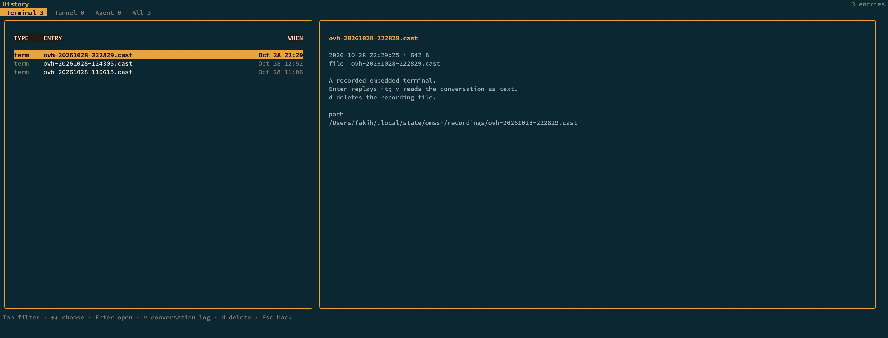
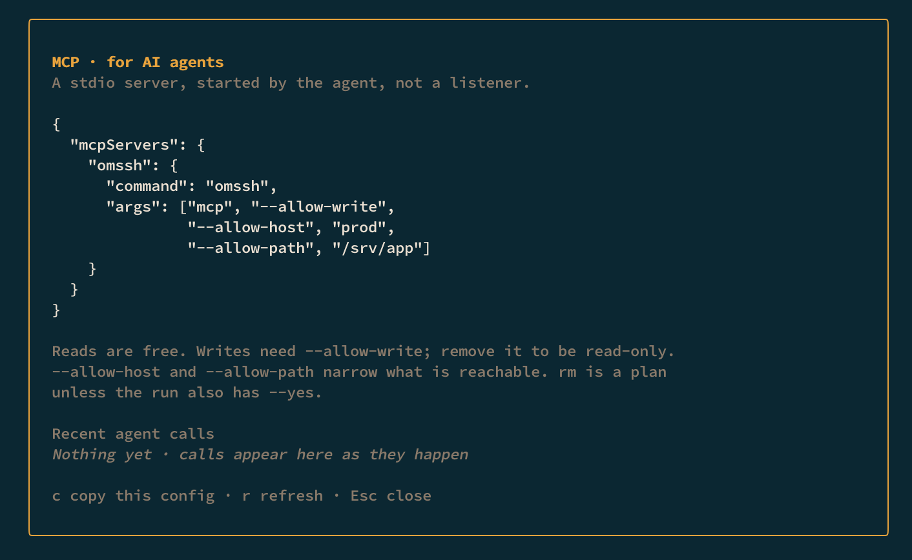

# omssh

**Oh My SSH** — a modern SSH and SFTP client for the terminal.

Many machines, one window.

<p align="center">
  
</p>

It starts on a launcher, not a blank prompt: **Manage connections** (hosts from
`~/.ssh/config` and buckets, one screen per kind), **Dashboard** (which places to
show), your local files, a path to jump to, and the settings behind one key.
Connections you already have are listed here too, so coming back is the same
gesture as going in.

<p align="center">
  
</p>

The dashboard puts up to four places on screen as a 2×2 grid — local plus three
hosts, four hosts, or a bucket in the mix — each pane with its own path, selection
and history. Which four is a choice, asked before the dashboard opens. Files move
between any two of them, and the card in the middle is where a copy becomes an
unpacked tree or a single archive instead of a pile of files.

## Why this CLI tool suits you

- **Manage SSH connections.** Stop juggling SSH configs and aliases. omssh keeps
  the connections in one list and lets you use your own `ssh`, or its embedded
  SSH with history and replay.
- **SSH and cloud storage in one window.** Copy, move and delete between
  SSH↔SSH, SSH↔cloud, cloud↔SSH, or either↔local. S3, GCS, Azure Blob and WebDAV,
  with credentials in the OS keyring, not the config.
- **Manage tunneling.** Local, remote and SOCKS port forwarding from the same
  CLI, with saved profiles and a live dashboard.
- **Archive and extract out of the box.** Extract an archive straight into the
  other pane, or pack a selection into one, without running `tar`/`unzip` first.
- **Up to four panes.** Four sessions in one window with progress for every
  transfer. The grid shrinks to the number of places you actually opened.
- **Recorded sessions.** Embedded terminals and tunnels are recorded by default
  (`.cast`, replayable), so you can audit what happened — including what an agent
  did. Turn recording off in settings.
- **Built for agents.** `omssh fs` and `omssh mcp` expose the same places to an
  AI agent with JSON output, allowlists and an audit log.
- **Themes.** Several palettes and a mono theme, chosen from settings.

## See it

### Cloud storage, beside SSH

<p align="center">
  
</p>

A bucket is a place like a host. The same copy, archive, preview and deploy
actions work in both directions — S3, GCS, Azure Blob and WebDAV included.

<p align="center">
  
</p>

### Tunnels with a live dashboard

<p align="center">
  
</p>

Local (`L`), remote (`R`) and dynamic/SOCKS (`D`) forwards, saved automatically
when started. The dashboard shows every connection and its bytes while they move;
`p` starts the same tunnel on another port, `c` checks the server's sshd and
firewall.

### Embedded terminal and replay

<p align="center">
  
</p>

`U` opens a recorded terminal in the window; mouse-drag copies, `Ctrl+V` pastes,
`Ctrl+]` detaches without ending the shell. History lists the recordings, plays
them back with play/seek/speed/search, and shows the conversation log as text.

### MCP for AI agents

<p align="center">
  
</p>

`omssh mcp` is a stdio MCP server: list, read, copy and extract with the same
allowlists and audit log. The launcher's MCP card copies the client configuration
and shows what the agent has been doing.

## Install

```sh
brew tap fakihariefnoto/tap && brew install fakihariefnoto/tap/omssh
```

or

```sh
go install github.com/fakihariefnoto/omssh/cmd/omssh@latest
```

Prebuilt archives for macOS and Linux (amd64 and arm64) are on the
[releases page](https://github.com/fakihariefnoto/omssh/releases).

From source: Go 1.26 or newer.

```sh
git clone https://github.com/fakihariefnoto/omssh
cd omssh
make run
```

## First five minutes

```sh
omssh              # the launcher
omssh prod         # the interface, already connected to prod
```

1. `Ctrl+O` opens **Manage connections** — hosts and buckets, one screen per kind.
   `Enter` browses one, `t` opens a terminal on it, `a` adds one (the form asks
   whether you mean a host or a bucket). `Esc` returns to the launcher.
2. **Dashboard** on the launcher asks which places it should show — local is
   optional, and buckets need no session. Up to four panes, 2×2. `w` moves the
   focus, `Tab` cycles sessions.
3. Mark a file with `y`, move to another pane, press `p`. `A` opens the paste
   options if you want it unpacked or packed instead.
4. `Ctrl+E` extracts an archive into either side, `Ctrl+G` compresses the
   selection, `Alt+D` deploys a profile from your config.
5. `Ctrl+K` finds every action; `?` shows the keymap; `Ctrl+Q` quits.

The full guide — every key, every screen, configuration — is in
**[DOCUMENTATION.md](DOCUMENTATION.md)**. What is still missing, and in what
order: **[ROADMAP.md](ROADMAP.md)**.

## Configuration

Configuration lives in `~/.config/omssh/config.yaml` (`$XDG_CONFIG_HOME/omssh`
when set — the same path on macOS and Linux, so one config works on both). Start
from the commented example:

```sh
omssh config init     # write it
omssh config check    # validate it, with line numbers
omssh config path     # print the exact path
```

Connections normally live in `~/.ssh/config`, which omssh reads and writes in
place without touching directives it does not manage. A connection created with
a password is stored under `hosts:` here instead, with the secret in the OS
keyring. The config also holds preferences — theme, keymap overrides, transfer
behaviour, deploy profiles, saved tunnels, pinned and hidden hosts, and cloud
*profiles* (bucket, region, endpoint — no secrets).

Bucket credentials entered in the form are kept in the **OS keyring**. Leave them
blank and the standard AWS chain is used instead.

## Command line

```sh
omssh                            # the interface
omssh <host>                     # the interface, connected on startup
omssh exec <host> -- <command>   # one command, its exit status
omssh cloud list                 # object-storage profiles
omssh cloud check <profile>      # list a bucket root, and say what a 403 means
omssh cloud ls <profile> [path]
omssh cloud forget <profile>     # drop the stored access key
omssh fs ls prod:/srv/app        # files, one grammar for every place
omssh tunnel contabo -L 8080:db:5432
omssh mcp                        # MCP server over stdio
omssh keys                       # the effective keymap
omssh config path|init|check
omssh version
```

`exec` allocates no terminal unless you ask with `--tty`, and answers what a
connection asks: it prints an unknown host key's fingerprint before trusting it,
and reads passwords without echoing. `--json`, `--json-lines`, `--batch` and
`--allow-write`/`--allow-host`/`--allow-path` make the same commands usable by a
script or an agent.

## Development

```sh
make run              # build and launch
make build            # -> ./omssh
make check            # gofmt, vet, golangci-lint, tests with -race
make snapshot         # release archives, locally
make help             # every target
```

Ships for macOS and Linux. Windows is not claimed: the terminal and credential
paths have not been exercised there.

## Licence

MIT — see [LICENSE](LICENSE).
